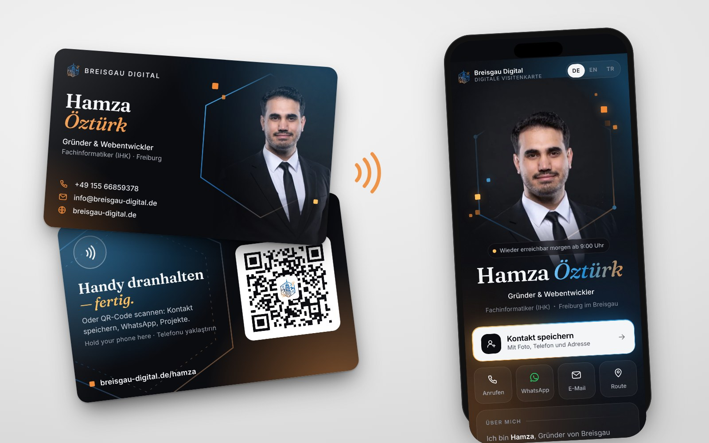

# NFC Kartvizit — Hamza Öztürk

İki parçadan oluşur:

1. **Dijital sayfa**: `https://breisgau-digital.de/hamza` (kaynak: `public/hamza/`).
   Kart telefona yaklaştırılınca ya da QR kod okutulunca bu sayfa açılır.
2. **Basılı kart**: bu klasördeki dosyalar.



## Dosyalar

| Dosya | Ne işe yarar |
| --- | --- |
| `visitenkarte-druck.pdf` | **Matbaaya gidecek dosya.** Sayfa 1 ön yüz, sayfa 2 arka yüz. |
| `vorderseite.png`, `rueckseite.png` | 300 dpi önizleme (2 mm taşma payı dahil). |
| `mockup.jpg` | Sunum görseli (kart + telefon). |
| `druckvorlage.html` | Kaynak dosya. Fontlar ve görseller içine gömülü; Chrome'da açılır. |

## Matbaa için ölçüler

- Son ölçü: **85,6 × 54 mm** (kredi kartı / ISO ID-1, PVC NFC kart).
- PDF ölçüsü: **89,6 × 58 mm** — her kenarda **2 mm taşma payı** (Anschnitt).
  PDF'te TrimBox/BleedBox tanımlı.
- Yazılar kesim çizgisinden en az 4 mm içeride.
- Fontlar PDF'e gömülü (TrueType). Renkler RGB; matbaadan CMYK'ya çevirmesini
  ve koyu zemini **rich black** (ör. C60 M40 Y40 K100) basmasını iste.
- Siparişte söylenecek: *„PVC-NFC-Karte, NTAG215 oder NTAG216, beidseitig
  4/4-farbig, abgerundete Ecken, Chip mit URL beschrieben."*

## Çipe ne yazılacak

```
https://breisgau-digital.de/hamza
```

Matbaa yazmıyorsa kendin yaz:

1. Telefona **NFC Tools** uygulamasını kur (iPhone ve Android).
2. *Yaz → Kayıt ekle → URL/URI* → yukarıdaki adresi gir.
3. *Yaz*'a bas, kartı telefonun arkasına tut.
4. Test et: ekran kilitliyken kartı telefona yaklaştır, sayfa açılmalı.
5. İstersen *Diğer → Kilitle* ile çipi kilitle. **Geri alınamaz**, o yüzden
   önce test et. Adres sabit kaldığı için sayfanın içeriğini istediğin zaman
   değiştirebilirsin — kartlara dokunmana gerek yok.

QR kod da aynı adrese gidiyor; NFC'si olmayan telefonlar için.

## Bilgiler değişirse

Telefon veya e-posta değişirse üç yerde güncellenmeli:

- `public/hamza/index.html` (sayfa)
- `public/hamza/hamza-oeztuerk.vcf` (rehbere kaydedilen kişi kartı)
- `druckvorlage.html` → Chrome'da aç → Yazdır → „PDF olarak kaydet",
  kenar boşlukları „Yok", „Arka plan grafikleri" açık.

Asıl şirket bilgileri `src/app/core/data/company.data.ts` içinde duruyor.

## Teknik notlar

- Sayfa tek bir statik HTML dosyası, Angular değil: NFC dokunuşunda zayıf
  internette bile anında açılsın diye. Çerez yok, dış sunucuya istek yok
  (bu yüzden çerez banner'ı da gerekmiyor).
- Dil: tarayıcı diline göre DE / EN / TR, sağ üstten değiştirilebilir.
- „Şu an ulaşılabilir" göstergesi Freiburg saatine göre Pzt–Cum 09:00–18:00.
- Sayfa `noindex`, sitemap'te yok; bakım modunda da açık kalır
  (`src/server/maintenance.ts`).
